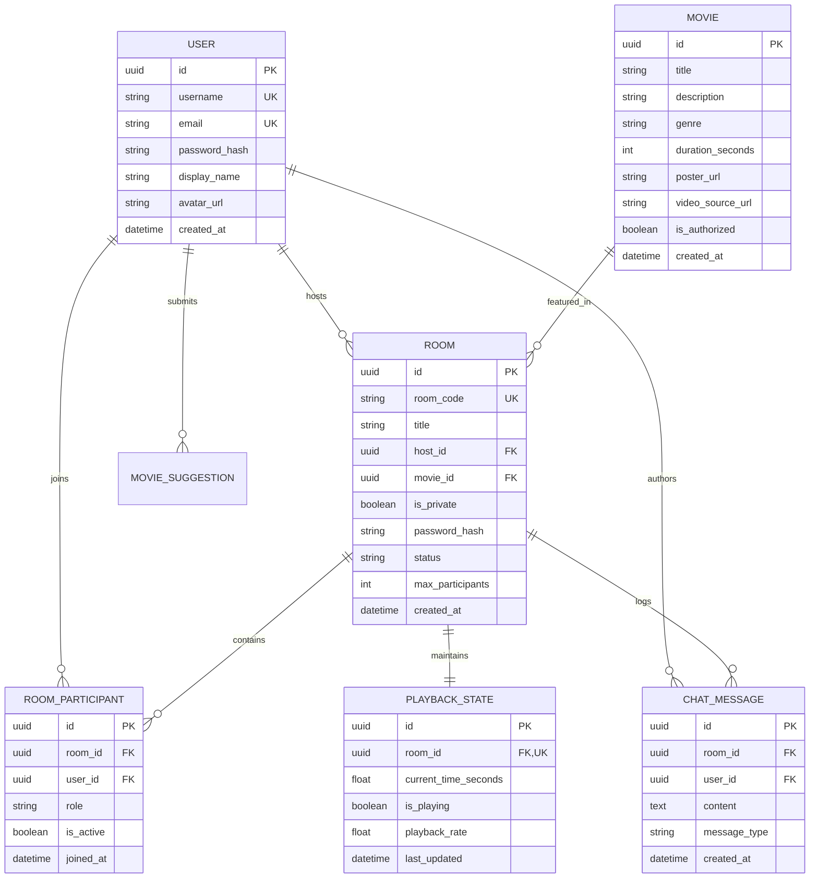

# Vybeora — Relational Database Architecture & Schema Design

This document details the PostgreSQL relational schema, entity relationships, constraints, and indexing strategies for the Vybeora platform.

---

## 1. Entity-Relationship (ER) Diagram

---

## 2. Table Specifications & Indexing Strategies

### `users_user`
- **Primary Key:** `uuid` (UUIDv4 for secure non-enumerable IDs)
- **Indexes:**
  - `username` (Unique index)
  - `email` (Unique index)

### `movies_movie`
- **Fields:** Title, Description, Genre, Release Year, Duration, Poster URL, Video URL.
- **Indexes:**
  - `title` (B-tree index for search queries)
  - `genre` (Filter index)

### `rooms_room`
- **`room_code`:** Unique alphanumeric nanoid (e.g. `vybe-7x9q`) for clean invite URLs.
- **`status`:** Enum: `active`, `paused`, `closed`.
- **Indexes:**
  - `room_code` (Unique index for instantaneous URL lookups)
  - `host_id` (Foreign key index)
  - `status` (Query filter index for active rooms)

### `rooms_roomparticipant`
- **Unique Constraint:** `(room_id, user_id)` (A user can only have one active participant record per room).
- **Cascade Rule:** `CASCADE` on room deletion; `SET_NULL` or `CASCADE` on user deletion.

### `rooms_playbackstate`
- **One-to-One:** Direct link to `room_id`. Stores current playback position in seconds, play/pause flag, and server timestamp for latency compensation.

### `chat_chatmessage`
- **Fields:** `room_id`, `user_id`, `content`, `message_type` (`text`, `emoji_reaction`, `system_announcement`).
- **Indexes:**
  - `(room_id, created_at DESC)` (Compound index for fast paginated chat history retrieval).
