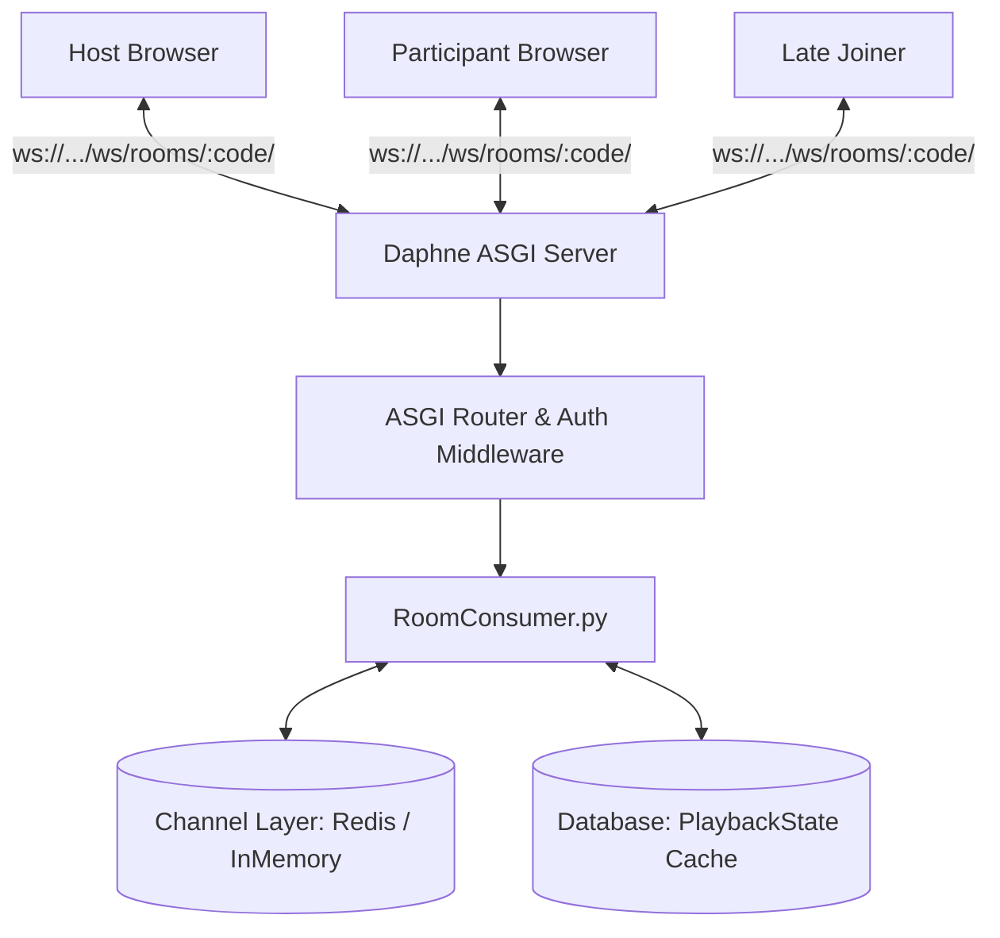

# Vybeora — Real-Time WebSocket Architecture & Synchronization Flow

This document details the bidirectional WebSocket protocol, event specifications, drift mitigation algorithms, and late-joining reconciliation implemented via Django Channels.

---

## 1. WebSocket Infrastructure Architecture



---

## 2. Standardized WebSocket Message Envelope

Every payload transmitted across the WebSocket connection conforms to a strict JSON framing standard:

```json
{
  "event": "playback.seek",
  "room_code": "vybe-8k3m",
  "sender": {
    "user_id": "9b1deb4d-3b7d-4bad-9bdd-2b0d7b3dcb6d",
    "username": "alex_cine",
    "is_host": true
  },
  "timestamp": 1729584000.123,
  "payload": {
    "current_time": 142.5,
    "is_playing": true,
    "playback_rate": 1.0
  }
}
```

---

## 3. Core Event Catalog

| Event Name | Direction | Trigger | Payload Contents |
| :--- | :--- | :--- | :--- |
| `room.connect` | Client ➔ Server | Initial handshake | `{ "auth_token": "..." }` |
| `room.sync_state` | Server ➔ Client | Upon connection or late join | `{ "current_time": 312.4, "is_playing": true, "media_url": "..." }` |
| `playback.play` | Host ➔ Server ➔ Group | Host hits Play | `{ "current_time": 45.2 }` |
| `playback.pause` | Host ➔ Server ➔ Group | Host hits Pause | `{ "current_time": 88.0 }` |
| `playback.seek` | Host ➔ Server ➔ Group | Host scrubs timeline | `{ "current_time": 210.5, "is_playing": true }` |
| `chat.message` | Client ➔ Server ➔ Group | User sends message | `{ "message_id": "...", "text": "What a twist!", "sent_at": "..." }` |
| `reaction.emoji` | Client ➔ Server ➔ Group | User triggers emoji reaction | `{ "emoji": "🔥", "x_offset": 0.45 }` |
| `participant.status` | Server ➔ Group | User joins or leaves | `{ "username": "sarah", "action": "joined", "total_count": 4 }` |

---

## 4. Playback Synchronization & Drift Mitigation Algorithm

To guarantee that participants stay in sync without jarring audio skips or constant buffering, Vybeora employs a three-tier drift tolerance algorithm:

Let:
- $T_{\text{host}}$ = Current host video timestamp
- $T_{\text{client}}$ = Current participant video timestamp
- $\Delta t = |T_{\text{host}} - T_{\text{client}}|$

```
┌────────────────────────────────────────────────────────┐
│ Threshold Tier 1: Micro-Jitter (Δt < 0.4 seconds)      │
│ Action: No action taken. Prevents audio micro-stutters.│
└────────────────────────────────────────────────────────┘
                          │
                          ▼
┌────────────────────────────────────────────────────────┐
│ Threshold Tier 2: Drift Adjustment (0.4s ≤ Δt < 1.5s)   │
│ Action: Subtly adjusts playbackRate to 1.05x or 0.95x  │
│ until Δt < 0.2s. Smooth, invisible human catch-up.     │
└────────────────────────────────────────────────────────┘
                          │
                          ▼
┌────────────────────────────────────────────────────────┐
│ Threshold Tier 3: Hard Resynchronization (Δt ≥ 1.5s)   │
│ Action: Hard seeks participant player to T_host + RTT/2│
│ immediately. Handled transparently.                    │
└────────────────────────────────────────────────────────┘
```

---

## 5. Late Joiner Reconciliation Protocol

When Participant C joins an ongoing movie 45 minutes into the screening:
1. `ClientC` initiates WebSocket connection to `/ws/rooms/<room_code>/`.
2. `RoomConsumer` validates membership, adds `ClientC` to channel group `room_<room_code>`.
3. `RoomConsumer` retrieves the active `PlaybackState` from memory/cache.
4. If video is currently playing, server computes elapsed delta since `last_updated`:
   $$T_{\text{catchup}} = T_{\text{saved}} + (T_{\text{now}} - T_{\text{last\_updated}})$$
5. Server sends dedicated `room.sync_state` frame to `ClientC` only.
6. `ClientC` player loads video asset, sets `video.currentTime = T_catchup`, and starts playing.
7. Server broadcasts `participant.status` to other members announcing `ClientC` has entered.
